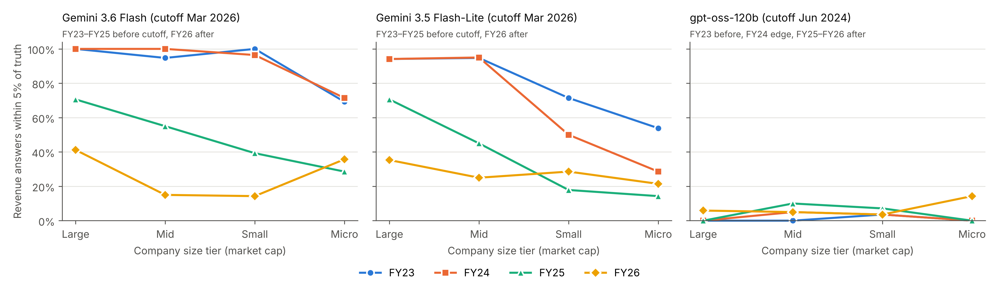

# Do AI Models Remember Indian Company Financials?

Data and code for the working paper **"Do AI Models Remember Indian Company Financials? Evidence on Look-Ahead Bias by Firm Size"** by Sethu Madhavan Chandavarapu (Manipal Institute of Technology, MAHE), October 2026.

Paper: [`paper.pdf`](paper.pdf) in this repository; SSRN link to be added once it is live.

## What this tests

If a language model has memorized a company's reported results, any backtest that asks it to "forecast" those results is contaminated by look-ahead bias. We ask three models for the revenue and net profit of 79 Indian listed companies (market value from ₹123 crore to ₹8.9 lakh crore) for FY23 to FY26, a range that spans each model's training cutoff, and score the answers against first-reported figures.

## Headline result

Share of revenue answers within 5% of the reported figure (best-estimate prompt, all 79 companies):

| Model | Training cutoff | FY23 | FY24 | FY25 | FY26 |
|---|---|---|---|---|---|
| Gemini 3.6 Flash | Mar 2026 | 94% | 94% | 48% | 24% |
| Gemini 3.5 Flash-Lite | Mar 2026 | 79% | 67% | 35% | 28% |
| gpt-oss-120b | Jun 2024 | 1% | 3% | 5% | 6% |
| Random walk (last year's revenue) | n/a | n/a | 17% | 15% | 18% |

Recall falls with firm size (about 11 percentage points per tenfold change in market value), and the larger Gemini model keeps near-complete recall further down the size range. Full results by size tier, with bootstrap confidence intervals, are in `results/table_main_hit5_revenue.csv`.

## Contents

| Path | What it is |
|---|---|
| `data/ground_truth.csv` | 79 companies: tier, market cap, revenue and net profit FY23–FY26 (₹ crore), audit notes and source links |
| `data/raw_batched.jsonl` | Every API attempt, including failed ones, with timestamp, model version and raw answer |
| `data/scored_answers_long.csv` | One row per model × prompt × company × year × metric, with the error measures used in the paper |
| `notebooks/01_collect.ipynb` | Study design, prompts and data collection (Google Colab) |
| `notebooks/02_score.ipynb` | Scoring, tables, regression, robustness checks and both figures |
| `results/` | Main table and robustness table as produced by notebook 2 |
| `figures/` | Figures 1 and 2 |

## Key columns

`ground_truth.csv`: `code` (NSE symbol or BSE code), `tier` (1_Large ≥ ₹1 lakh crore, 2_Mid ₹30,000–1 lakh crore, 3_Small ₹5,000–30,000 crore, 4_Micro < ₹5,000 crore), `mcap_cr`, `rev_fy23`…`rev_fy26`, `np_fy23`…`np_fy26`, `audit` (random or suspect), `audit_note`, `audit_source`, `fy23_basis` (consolidated or standalone).

`scored_answers_long.csv`: `model`, `variant` (strict = may return null; best = must answer, with a 0–100 confidence), `year`, `metric`, `pred`, `truth`, `ape` (|pred − truth| / |truth|), `hit5` (APE ≤ 5%; a missing answer counts as a miss), `hit1`, `unit_error`, `cutoff` (before, edge, after).

## Reproduce

**Re-score without any API key (about 2 minutes).** Put the three files from `data/` in a Google Drive folder named `llm_memorization_pilot`, open `notebooks/02_score.ipynb` in Google Colab and choose Runtime → Run all. The outputs match `results/` and `figures/`.

**Re-run the queries.** You need free API keys from Groq and Google AI Studio, stored in Colab Secrets as `GROQ_API_KEY` and `GEMINI_API_KEY`. In `notebooks/01_collect.ipynb`, run the setup cells and the cell under "Step 2, as actually run". Companies are asked in batches of ten because the Gemini free tier allows about 20 requests a day per model; the cell resumes where it stopped. Model versions change over time, so new answers will differ somewhat.

**Test another model.** Add it to `MODELS` in notebook 1 with its cutoff, collect, then add its cutoff mapping to `CUTOFF` in notebook 2.

## Data notes

- Ground truth is from Screener.in (collected 19–21 October 2026). Twelve companies were audited against first-reported exchange filings; six restated figures were replaced with the first-reported values and two micro-caps' profits with exact decimals. Details and links are in `audit_note` and `audit_source`.
- For 12 companies the figures are standalone rather than consolidated (`fy23_basis`).
- FY23 is missing for Linde India (15-month year) and Owais Metal (not yet listed).
- This is a pilot: 79 companies from four sectors, not a random sample of listed firms.

## Use of AI tools

Generative AI (Anthropic's Claude) was used extensively in this work: to help design the study, write the data-collection and analysis code, collect and audit the ground-truth figures, and draft the text. The author ran all model queries and analyses, checked audited figures against the original company filings, spot-checked reported numbers against the outputs, reviewed the results and the text, and takes full responsibility for the content. Every reported number was re-checked against the underlying data in a separate verification pass.

## Citation

Chandavarapu, S. M. (2026). Do AI Models Remember Indian Company Financials? Evidence on Look-Ahead Bias by Firm Size. Working paper.

## Licence

Code: MIT (see `LICENSE`). Data: CC BY 4.0. The financial figures are facts from company filings, collected through Screener.in; please cite the original filings where relevant.

Contact: imsethu007@gmail.com
